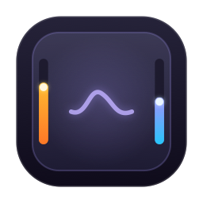

# Glide

<p align="center">
  
</p>

<p align="center">
  <strong>Native macOS Menu-Bar Utility for MacBook Trackpad Edge Gestures</strong>
</p>

<p align="center">
  <a href="https://swift.org"></a>
  <a href="https://apple.com/macos"></a>
  
  
  
  <a href="LICENSE"></a>
</p>

---

## 🌟 Open Source & Free for Everyone

**Glide is 100% free and open-source software under the [MIT License](LICENSE).**

Everyone is welcome to use, study, customize, fork, and contribute to this project. No paywalls, no telemetry, no background daemons, and zero third-party dependencies.

Created and maintained with ❤️ by **[Anshul Garg](http://anshulgarg.in/)**.

---

## ⚡ Lean, Fast & Zero Bloat

Glide was engineered with an uncompromising focus on native speed, simplicity, and minimal disk footprint:

- 🪶 **Under 1 MB on Disk**: The entire uncompressed `Glide.app` bundle is only **~570 KB** (and the download zip is just **~325 KB**). It takes virtually unnoticeable space on your SSD.
- 🚫 **Zero Third-Party Dependencies**: Built 100% in pure native Swift with no external pods, packages, or bloat. No Electron, no Chromium web views, and no heavy runtimes.
- ⏱️ **0.0% Idle CPU**: Completely event-driven via direct Apple Multitouch contact callbacks. When you're not actively sliding along the edges, Glide sleeps at 0% CPU and preserves battery.
- 🧠 **Minimal RAM Footprint**: Consumes only standard AppKit/SwiftUI system memory (~15–20 MB).
- ⚡ **Instant Launch**: Starts in milliseconds and runs quietly in the macOS menu bar.

---

## 📥 Download & Quick Start

You do **not** need to compile Glide yourself to use it:

1. **Download**: Get the latest **[`Glide.zip`](https://github.com/anshulg8/glide/releases/latest)** from GitHub Releases.
2. **Install**: Double-click `Glide.zip` to extract, then drag **`Glide.app`** into your **Applications** folder.  
   *(Or open it directly in Downloads — Glide will automatically offer to move itself to Applications for you!)*
3. **First Launch (macOS Gatekeeper)**:  
   Because Glide is free, open-source software and not notarized through a paid Apple Developer subscription ($99/year), macOS will show a standard first-launch warning:
   - **System Settings (Standard macOS 15 Sequoia flow)**:  
     Double-click `Glide.app` → click **Done** on the warning → open **System Settings** → **Privacy & Security** → scroll down to **Security** → click **Open Anyway**.
   - **Terminal (Fastest one-liner)**:  
     ```bash
     xattr -cr /Applications/Glide.app
     ```
   *(You only need to approve it once; macOS permanently remembers it thereafter).*

---

## 🔒 Permissions: None Required!

Unlike most trackpad or gesture utilities, **Glide requires ZERO system permissions**:
- ❌ **No Accessibility Permissions** needed.
- ❌ **No Input Monitoring** permissions needed.
- ❌ **No Screen Recording** permissions needed.
- ❌ **No Helper Daemons or Kernel Extensions** installed.

Glide communicates directly with Apple's low-level Multitouch and Display frameworks in user space, operating completely sandboxed from your private keystrokes and data.

---

## 💻 Hardware & System Compatibility

### Compatible Macs:
- **MacBook Pro**: 2015 and later (Intel & all Apple Silicon M1, M2, M3, M4 models).
- **MacBook Air**: 2018 and later (Intel & all Apple Silicon M1, M2, M3, M4 models).
- **Desktop Macs**: Mac mini, Mac Studio, iMac, Mac Pro when paired with an external **Apple Magic Trackpad 2 or 3** (Bluetooth or USB).

### Supported OS:
- **macOS 14.0 (Sonoma)** or newer (including **macOS 15 Sequoia**).

> **Note on Screen Brightness**: Display brightness control communicates directly with built-in laptop displays and Apple Studio Display / Pro Display XDR via Apple's native `DisplayServices.framework`. System volume control works across all audio output devices (built-in speakers, headphones, AirPods, HDMI, external DACs).

---

## ✨ Features & Capabilities

- **Left Edge Slide**: Smoothly adjusts display brightness (0% to 100%) via Apple's private `DisplayServices.framework`.
- **Right Edge Slide**: Smoothly adjusts system output volume (0% to 100%) via CoreAudio.
- **Hardware Taptic Engine Feedback (`MTActuator`)**:
  - Crisp Force Touch mechanical click when a gesture engages or toggles mute (Actuation ID 6).
  - Subtle ratchet micro-ticks every ~3.5% adjustment increment as you slide (Actuation ID 1).
- **Rock-Solid Cursor Freeze**: The mouse pointer stays completely pinned and stationary during edge slides (`CGAssociateMouseAndMouseCursorPosition(0)` and per-frame `CGWarpMouseCursorPosition`), restoring seamlessly upon release without jumping.
- **Interactive Horizontal Sliders**: The menu bar popup features space-saving horizontal Brightness and Volume tracks that you can tap or drag directly, with real-time bidirectional sync.
- **Fine Control (`⇧ Shift` / `⌥ Option`)**: Holding Shift or Option scales adjustment speed down to `0.25×` for precision quarter-steps.
- **Quick Mute Corner Tap**: Double-tapping the top-right corner of the trackpad toggles system mute with haptic feedback.
- **Screen-Aware HUD Overlay**: Floating non-activating bezel (`NSPanel`) displaying volume/brightness icons and smooth progress bars on whichever monitor currently contains the cursor, fading after 1.2s.
- **Click-Outside Auto-Dismiss**: The menu bar dropdown automatically dismisses whenever you click anywhere outside or press Escape.
- **Preferences & Menu Bar UI**:
  - Menu-bar popup with sliders for Sensitivity, Edge Zone width, and feature toggles.
  - Settings sheet with side swapping, active height zone restriction (Entire Edge, Bottom Half, Bottom Quarter), modifier-key requirement, appearance theme, and launch at login (`SMAppService`).
- **Resource Efficient**: `LSUIElement = true` (runs exclusively in the menu bar without a Dock icon; 0% CPU at idle; ~320 KB release binary).

---

## 🛠 Project Structure

```
glide/
├── LICENSE                    # MIT Open Source License
├── Package.swift              # Pure SPM definition (zero external dependencies)
├── README.md
├── Resources/
│   ├── AppIcon.icns           # High-resolution application icon
│   ├── AppIcon.png            # 256x256 PNG for web & README
│   └── Info.plist             # LSUIElement = true accessory configuration
├── scripts/
│   ├── bundle.sh              # Build release SPM binary, package Glide.app & Glide.zip, sign
│   └── generate_icon.swift    # App icon asset generator
└── Sources/
    └── Glide/
        ├── App.swift                  # NSApplicationDelegate, status item, popover lifecycle
        ├── Gestures/
        │   ├── BrightnessController.swift     # DisplayServices dynamic loader
        │   ├── GestureConfiguration.swift     # Observable settings & UserDefaults persistence
        │   ├── GestureOverlayController.swift # Screen-aware HUD bezel panel
        │   ├── MultitouchSupportBridge.swift  # MultitouchSupport & MTActuator bridge
        │   ├── TrackpadGestureManager.swift   # Gesture state machine, warp & haptics
        │   └── VolumeController.swift         # CoreAudio volume & mute controller
        └── UI/
            ├── AboutView.swift                # Dedicated About window
            ├── MenuBarPopupView.swift         # Main menu bar dropdown with horizontal sliders
            └── SettingsView.swift             # Settings sheet with first-class controls
```

---

## 🔨 Building from Source

If you prefer to compile Glide yourself:

### 1. Clone the Repository
```bash
git clone https://github.com/anshulg8/glide.git
cd glide
```

### 2. Build & Package `.app`
```bash
./scripts/bundle.sh release
```
This produces both `Glide.app` and `Glide.zip` in the root folder.

### 3. Launch
```bash
open Glide.app
```

---

## 🤝 Contributing

Contributions, bug reports, and feature requests are welcome!
1. Fork the repository
2. Create your feature branch (`git checkout -b feature/amazing-feature`)
3. Commit your changes (`git commit -m "Add amazing feature"`)
4. Push to the branch (`git push origin feature/amazing-feature`)
5. Open a Pull Request

---

## 📄 License

This project is licensed under the **MIT License** — see the [LICENSE](LICENSE) file for details.

Developed with ❤️ by **[Anshul Garg](http://anshulgarg.in/)**.
